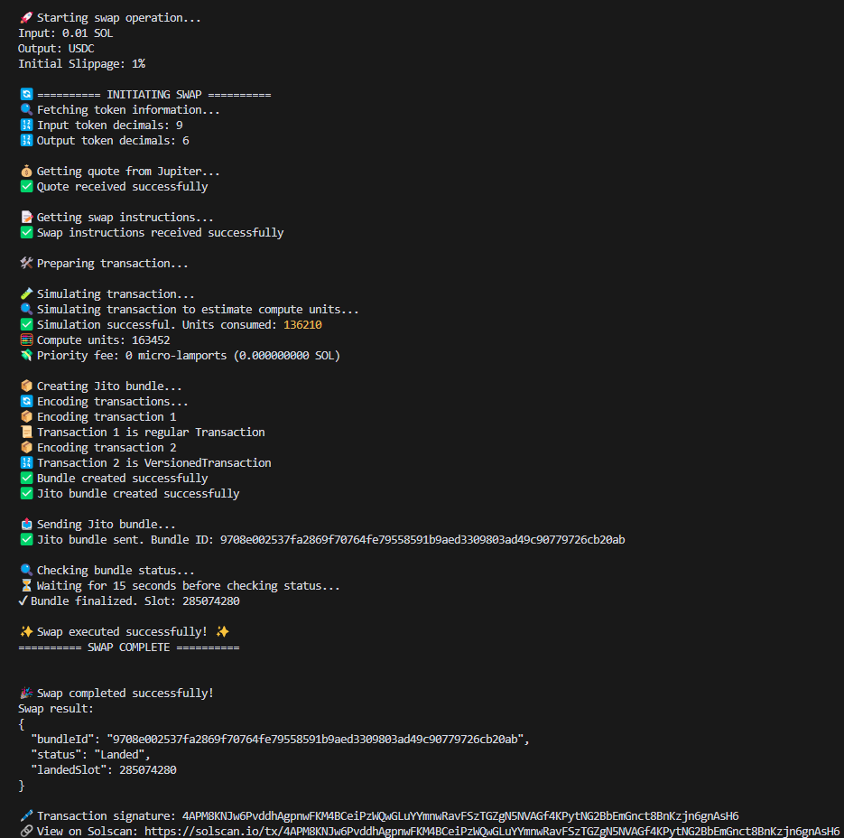

# Solana Jupiter Swap Tutorial

> **The definitive Solana Jupiter Swap Tutorial.** Execute production-grade token swaps on Solana using the Jupiter Aggregator V6 API, Jito MEV-protected bundles, versioned transactions, Address Lookup Tables (ALTs), and fully dynamic priority fees — with complete source in both JavaScript and TypeScript.

[](https://solana.com)
[](https://jup.ag)
[](https://jito.wtf)
[](https://www.typescriptlang.org)
[](https://developer.mozilla.org)



---

## Table of Contents

1. [What You Will Learn](#1-what-you-will-learn)
2. [How a Jupiter Swap Actually Works on Solana](#2-how-a-jupiter-swap-actually-works-on-solana)
3. [Project Structure](#3-project-structure)
4. [Prerequisites](#4-prerequisites)
5. [Installation](#5-installation)
6. [Environment Variables — Every Option Explained](#6-environment-variables--every-option-explained)
7. [Running the JavaScript Version](#7-running-the-javascript-version)
8. [Running the TypeScript Version](#8-running-the-typescript-version)
9. [Code Walkthrough — Module by Module](#9-code-walkthrough--module-by-module)
   - 9a. [config.js — Bootstrapping the Solana Connection](#9a-configjs--bootstrapping-the-solana-connection)
   - 9b. [jupiterApi.js — Talking to the Jupiter Aggregator](#9b-jupiterapisjs--talking-to-the-jupiter-aggregator)
   - 9c. [transactionUtils.js — Building the Actual Transaction](#9c-transactionutilsjs--building-the-actual-transaction)
   - 9d. [utils.js — Token Info & Dynamic Priority Fees](#9d-utilsjs--token-info--dynamic-priority-fees)
   - 9e. [jitoService.js — MEV-Protected Bundle Submission](#9e-jitoservicejs--mev-protected-bundle-submission)
   - 9f. [validation.js & errors.js — Guarding the Edges](#9f-validationjs--errorsjs--guarding-the-edges)
   - 9g. [index.js — The Orchestrator](#9g-indexjs--the-orchestrator)
10. [Deep Dive: Address Lookup Tables on Solana](#10-deep-dive-address-lookup-tables-on-solana)
11. [Deep Dive: Transaction Simulation & Compute Budget](#11-deep-dive-transaction-simulation--compute-budget)
12. [Deep Dive: Jito Bundles & MEV Protection](#12-deep-dive-jito-bundles--mev-protection)
13. [What the TypeScript Version Adds](#13-what-the-typescript-version-adds)
14. [Real-World Use Cases](#14-real-world-use-cases)
15. [Best Practices & Common Pitfalls](#15-best-practices--common-pitfalls)
16. [Contact](#16-contact)

---

## 1. What You Will Learn

This is not a toy snippet. Every file in this repository maps to a real problem you hit when you move past "hello swap" on Solana DeFi. By the time you have read through the code and this document you will be able to:

- Query the **Jupiter Aggregator API (V6)** for optimal multi-hop swap routes across every major Solana DEX.
- Convert Jupiter's raw instruction payload into a signed **VersionedTransaction (v0)** that Solana will actually accept.
- Compress that transaction using **Address Lookup Tables** so it stays under Solana's 1232-byte packet limit.
- Calculate **priority fees at runtime** from live network data instead of guessing a number.
- Wrap the swap in a **Jito bundle** so no bot can sandwich it.
- Simulate the transaction first, extract the real compute usage, and set an exact **compute budget** — no wasted lamports.

---

## 2. How a Jupiter Swap Actually Works on Solana

Jupiter is a **DEX aggregator**, not a DEX itself. It owns no liquidity pools. What it does is route your swap across whichever combination of AMMs on Solana (Raydium, Orca, Phoenix, Meteora, and others) gives you the best output for your input. It may split your trade across multiple pools in the same transaction if that yields a better rate.

Here is the full request-response lifecycle this tutorial implements, start to finish:

```
Your wallet                Jupiter API (quote-api.jup.ag)
     |                            |
     |  -- GET /v6/quote -------> |   Step 1: ask Jupiter for the best
     |                            |            route and expected output
     |  <-- QuoteResponse -----   |
     |                            |
     |  -- POST /v6/swap ------> |   Step 2: hand the quote back;
     |      (quote + wallet pk)   |            receive unsigned instructions
     |                            |
     |  <-- swap instructions --  |
     |                            |
     v
 transactionUtils
     |
     |  deserialize instructions  Step 3: convert JSON -> TransactionInstruction
     |  fetch ALT accounts               objects; pull in the lookup tables
     |  simulate transaction             Jupiter said to use
     |  add 20 % compute buffer   Step 4: dry-run the tx to learn exact
     |  sign VersionedTransaction        compute cost; pad it; sign
     v
 jitoService
     |
     |  build tip transaction     Step 5: create a second tx that pays
     |  (same blockhash)                 the Jito validator tip
     |
     |  POST bundle to            Step 6: ship both transactions as one
     |  Block Engine                     atomic bundle
     |
     |  poll for confirmation     Step 7: wait for "Landed" status
     v
  Done
```

**Why two API calls to Jupiter?** The `/v6/quote` endpoint is lightweight and rate-limit-friendly. You can call it in a loop to watch prices move without ever signing anything. The `/v6/swap` call is heavier — you only make it when you are ready to commit.

---

## 3. Project Structure

```
Solana-Token-Swap-Tutorial/
|
|  -- JavaScript version (runs from root) ---------------
|-- index.js                  Entry point.  main() -> swap()
|-- config.js                 Loads .env -> exports Connection + Keypair
|-- jupiterApi.js             getQuote()  +  getSwapInstructions()
|-- jitoService.js            getTipAccounts() / createJitoBundle() / sendJitoBundle()
|-- transactionUtils.js       deserializeInstruction() / ALT fetch / simulate
|-- utils.js                  getTokenInfo() / getAveragePriorityFee()
|-- validation.js             Input guards (mint, amount, slippage)
|-- errors.js                 Typed error classes
|-- .env.example              Every env var with inline comments
|-- .babelrc                  Babel config (ES-module import/export in Node)
|
|  -- TypeScript version (self-contained sub-project) ---
|-- solana-swap-tutorial-typescript/
|   |-- src/
|   |   |-- index.ts          Typed entry -- adds retry + slippage escalation
|   |   |-- config.ts
|   |   |-- jupiterApi.ts
|   |   |-- jitoService.ts    Adds ALT-fetch fallback over the JS version
|   |   |-- transactionUtils.ts
|   |   |-- utils.ts
|   |   |-- validation.ts
|   |   `-- errors.ts
|   |-- tsconfig.json
|   `-- package.json          scripts: build | start | dev
|
|-- images/
|   `-- solana_swap_process.png
|-- CONTRIBUTING.md
`-- README.md                 <- this file
```

The JavaScript and TypeScript versions are **functionally identical at their core**. The TypeScript version layers on retry logic and ALT resilience on top. Pick whichever fits your project.

---

## 4. Prerequisites

| Requirement | Why |
|---|---|
| Node.js >= 18 | Native `fetch` is used everywhere — no polyfills |
| npm >= 6 | Dependency resolution |
| A funded Solana mainnet wallet | The default demo swaps 0.01 SOL; you also need a tiny reserve for fees |
| A Solana RPC endpoint | Public endpoint works for learning; use a private one (Helius, QuickNode) for anything real |

---

## 5. Installation

```bash
git clone https://github.com/fiv3fingers/Solana-Token-Swap-Tutorial.git
cd Solana-Token-Swap-Tutorial

npm install

cp .env.example .env
# edit .env — at minimum fill SOLANA_RPC_URL and WALLET_PRIVATE_KEY
```

No on-chain deployment. No program compilation. Everything the script calls is already live on Solana mainnet.

---

## 6. Environment Variables — Every Option Explained

The `.env.example` file is the single source of truth. Here it is, annotated by category.

### 6a. Required — the script will not start without these

```env
SOLANA_RPC_URL=https://your-rpc-url-here
WALLET_PRIVATE_KEY=[your,private,keypair,array,here]
```

`WALLET_PRIVATE_KEY` is a JSON-style array of byte values (the format `Keypair.fromSecretKey` expects). You can export it from any Solana wallet CLI.

### 6b. Jito bundle endpoint & tip tuning

```env
# Which Block Engine region to POST bundles to.
# Pick the one geographically closest to your server.
JITO_BUNDLE_URL=https://mainnet.block-engine.jito.wtf/api/v1/bundles

# Up to two fallback regions the code rotates to on failure.
# JITO_BUNDLE_URL_FALLBACK_1=https://ny.mainnet.block-engine.jito.wtf/api/v1/bundles
# JITO_BUNDLE_URL_FALLBACK_2=https://amsterdam.mainnet.block-engine.jito.wtf/api/v1/bundles

# Tip = tip_floor x this value.  1.5 means you bid 50 % above the floor.
JITO_TIP_MULTIPLIER=1.5

# If the tip_floor endpoint is unreachable, use this absolute minimum.
JITO_MIN_TIP_LAMPORTS=1000

# First-attempt tip floor can be higher to increase landing probability.
JITO_FIRST_ATTEMPT_MIN_TIP_LAMPORTS=5000
```

### 6c. Priority fee tuning

```env
# Which percentile of the last ~150 slots' fees to use.
# 75 is the safe default; go to 90+ during congestion events.
PRIORITY_FEE_PERCENTILE=75

# Hard floor / ceiling in micro-lamports.
PRIORITY_FEE_MIN_MICROLAMPORTS=10000
PRIORITY_FEE_MAX_MICROLAMPORTS=1000000

# Optional: delegate fee estimation to a provider (Helius / QuickNode).
# PRIORITY_FEE_PROVIDER_URL=https://mainnet.helius-rpc.com/?api-key=YOUR_KEY
# PRIORITY_FEE_PROVIDER_METHOD=getPriorityFeeEstimate
# PRIORITY_FEE_ACCOUNT_KEYS=ComputeBudget111111111111111111111111111111
```

### 6d. TypeScript-only extras (in solana-swap-tutorial-typescript/.env)

```env
JITO_TIP_BASE=ema50                    # baseline statistic: ema50|p50|p75|p95|p99
JITO_TIP_ESCALATION=1.0,1.2,1.5,2.0   # multiplier ramp across retries
JITO_MAX_TIP_LAMPORTS=2000000          # absolute ceiling to prevent runaway bids
PRIORITY_FEE_FLOOR_MICROLAMPORTS=10000
```

---

## 7. Running the JavaScript Version

```bash
# from the repo root
npm start
```

That fires `index.js`, which swaps **0.01 SOL -> USDC** end to end and logs every stage.

### Changing the swap

Open `index.js`, find `main()`, and edit these four values:

```js
const inputMint  = "So11111111111111111111111111111111111111112"; // wSOL
const outputMint = "EPjFWdd5AufqSSqeM2qN1xzybapC8G4wEGGkZwyTDt1v"; // USDC
const amount     = 0.01;   // human-readable SOL; converted to lamports by getTokenInfo()
const slippage   = 100;    // basis points (100 bps = 1 %)
```

Look up any token's mint address on [Solscan](https://solscan.io) or [Jupiter's token list](https://jup.ag/tokens).

---

## 8. Running the TypeScript Version

```bash
cd solana-swap-tutorial-typescript

npm install
cp ../.env.example .env   # or write your own

# --- one-time build ---
npm run build             # tsc -> dist/
npm start                 # node dist/index.js

# --- development (hot-reload) ---
npm run dev               # ts-node --watch
```

Edit `src/index.ts` to change swap parameters. The TypeScript version **automatically retries** up to `maxRetries` (default 5) times, escalating slippage each attempt.

---

## 9. Code Walkthrough — Module by Module

### 9a. config.js — Bootstrapping the Solana Connection

This is the first module every other file imports. It does exactly two things:

1. Reads `SOLANA_RPC_URL` from `.env` and creates a `Connection` instance.
2. Reads `WALLET_PRIVATE_KEY`, parses the byte array, and produces a `Keypair`.

Nothing else in the codebase touches `dotenv` directly. All secrets flow through here.

### 9b. jupiterApi.js — Talking to the Jupiter Aggregator

Two exported functions, two HTTP calls.

**`getQuote(inputMint, outputMint, amountInSmallestUnit, slippageBps)`**

```
GET https://quote-api.jup.ag/v6/quote
    ?inputMint=<mint>
    &outputMint=<mint>
    &amount=<lamports>
    &slippageBps=<bps>
```

Jupiter returns a `QuoteResponse` object. The important fields are `outAmount` (what you will receive), `priceImpactPct` (how much you are moving the market), and the full route — which pools, in which order, with what intermediary tokens. This is the Solana DeFi equivalent of getting a price quote from a stock exchange before you place an order.

**`getSwapInstructions(quoteResponse, walletPublicKey)`**

```
POST https://quote-api.jup.ag/v6/swap
     body: { quoteResponse, userPublicKey }
```

Jupiter takes the route it already computed and returns the **unsigned transaction instructions** needed to execute it. These arrive as plain JSON objects — `programId`, `accounts`, `data` — not as native `TransactionInstruction` instances. That conversion is `transactionUtils.js`'s job.

### 9c. transactionUtils.js — Building the Actual Transaction

Three functions. Each one solves a distinct problem that blocks you from turning Jupiter's JSON into something Solana will accept.

**`deserializeInstruction(rawInstruction)`** — Takes one of Jupiter's JSON instruction objects and returns a proper `TransactionInstruction`. It maps the string `programId` to a `PublicKey`, reconstructs the `accounts` array with the correct `isSigner` / `isWritable` flags, and base64-decodes the `data` field into a `Buffer`.

**`getAddressLookupTableAccounts(connection, altAddresses)`** — Jupiter's routes routinely touch 15–30 on-chain accounts. Each one is a 32-byte public key. Without ALTs those keys are inlined in the transaction body and the byte count explodes. Jupiter returns a list of ALT addresses that cover its route. This function fetches each table from the network, deserialises it, and hands the array to the `MessageV0` constructor so they can be referenced by index instead.

**`simulateTransaction(connection, transaction)`** — Runs `connection.simulateTransaction()` against the fully assembled (but unsigned) transaction. Solana executes it in a sandbox and reports `unitsConsumed`. The function adds a **20 % safety buffer** and returns that number, which becomes the argument to `ComputeBudgetProgram.setComputeUnitLimit`.

### 9d. utils.js — Token Info & Dynamic Priority Fees

**`getTokenInfo(mint)`** — Fetches the token's metadata (specifically its `decimals` value) from Jupiter's on-chain token list. This is how `0.01 SOL` becomes `10_000_000 lamports` — the conversion happens here, not in the swap logic itself.

**`getAveragePriorityFee(connection)`** — Calls `connection.getRecentPrioritizationFees()`. That RPC method returns the actual priority fees that landed in roughly the last 150 confirmed slots. The function averages them and returns the result. This average is fed to `ComputeBudgetProgram.setComputeUnitPrice`.

Why not just pick a number? Solana priority fees are a real-time auction. A fee of 1000 micro-lamports will sail through at 3 AM; it will time out during a token-launch congestion spike. Sampling recent history is the simplest strategy that adapts automatically.

### 9e. jitoService.js — MEV-Protected Bundle Submission

This module is the most Solana-specific piece in the entire tutorial. Three functions.

**`getTipAccounts()`** — GETs a list of wallet addresses from `bundles.jito.wtf`. One of these addresses receives the tip payment you make to the validator who will include your bundle. Tip accounts are cached for 60 seconds to avoid rate-limiting the endpoint.

**`createJitoBundle(swapTransaction, tipAmountLamports)`** — Assembles the two-transaction bundle. The tip amount is calculated by fetching the current `tip_floor` from Jito and multiplying by `JITO_TIP_MULTIPLIER`. Critically, both the swap transaction and the tip transaction are built with the **same `recentBlockhash`**. If they had different blockhashes a slot boundary could invalidate one while the other is still valid, and the bundle would fail.

**`sendJitoBundle(bundle)`** — POSTs the base64-serialised bundle to the configured Block Engine endpoint. The bundle order is `[swapTx, tipTx]` — swap first. Then it polls for confirmation using a three-tier fallback: first `getInflightBundleStatuses` (covers the last five minutes), then `getBundleStatuses` (historical, includes transaction signatures), and finally a direct Solana RPC `getSignatureStatuses` call on the main swap transaction. Polling uses gentle backoff (2 s -> 5 s) and caps out at 120 seconds.

### 9f. validation.js & errors.js — Guarding the Edges

`validation.js` exports three guards that run **before** any network call:

- **`validateMint`** — ensures the mint string is a valid base58 Solana public key.
- **`validateAmount`** — rejects zero, negative, or non-numeric amounts.
- **`validateSlippage`** — keeps slippage within a sensible range.

`errors.js` defines domain-specific error classes — `SwapError`, `ValidationError`, `JitoError` — so that the catch blocks in `index.js` can log exactly where things went wrong instead of bubbling a generic `Error`.

### 9g. index.js — The Orchestrator

`index.js` is the only file that imports the others. The `swap()` function is a straight pipeline:

1. Validate inputs via `validation.js`.
2. Fetch token decimals via `getTokenInfo()` -> convert human-readable amount to smallest unit.
3. `getQuote()` -> confirm the route exists and the price impact is acceptable.
4. `getSwapInstructions()` -> get the raw instructions from Jupiter.
5. Deserialize every instruction with `deserializeInstruction()`.
6. Fetch and resolve the ALTs Jupiter specified with `getAddressLookupTableAccounts()`.
7. Simulate the transaction -> extract `unitsConsumed`.
8. Build the `ComputeBudget` instructions (unit limit from simulation + unit price from `getAveragePriorityFee()`).
9. Assemble a `VersionedTransaction` (v0) with all instructions and ALTs, sign it.
10. `createJitoBundle()` -> attach the tip transaction.
11. `sendJitoBundle()` -> submit and wait for confirmation.

`main()` calls `swap()` with the default parameters (0.01 SOL -> USDC) and is the only thing that runs when you do `npm start`.

---

## 10. Deep Dive: Address Lookup Tables on Solana

A Jupiter swap route may touch 15–30 distinct on-chain accounts — pool vaults, token mints, the Jupiter program ID itself, various AMM program IDs. In a **legacy** Solana transaction each of those accounts has to appear as a full 32-byte public key inlined in the transaction body. That is 480–960 bytes just for the account list, pushing right up against (or over) the 1232-byte hard limit.

**Address Lookup Tables (ALTs)** are an on-chain data structure that stores up to 256 public keys in a compact indexed array. A **VersionedTransaction (v0)** — the only transaction format that supports ALTs — can reference an ALT by its own public key and then cite individual addresses within it by their **single-byte index**. The math: 32 bytes per inline key drops to 1 byte per ALT-referenced key.

Jupiter maintains ALTs that cover the accounts its routes use. When you call `/v6/swap` the response includes the list of ALT addresses relevant to your route. `getAddressLookupTableAccounts()` fetches those tables, and the `MessageV0` constructor packs them into the transaction's address-table-lookups section.

This is also the reason the tutorial uses `VersionedTransaction` everywhere instead of the older `Transaction` class — ALTs simply do not work with legacy transactions.

---

## 11. Deep Dive: Transaction Simulation & Compute Budget

Every Solana transaction must declare its compute budget up front via two `ComputeBudgetProgram` instructions:

| Instruction | Sets |
|---|---|
| `setComputeUnitLimit(n)` | Maximum compute units this transaction is allowed to consume |
| `setComputeUnitPrice(price)` | How many lamports per compute unit you are paying as a priority fee |

If you set the limit too low the transaction hits the ceiling mid-execution and fails on-chain. If you set it too high you are paying for units you never used.

The tutorial's approach:

1. Assemble the transaction with all swap instructions and ALTs.
2. Call `connection.simulateTransaction()`. Solana runs it in a read-only sandbox and returns `unitsConsumed` — the actual number of compute units the transaction used.
3. Multiply by 1.2 (the 20 % safety buffer). Occasional nondeterminism in on-chain execution means the real cost can creep slightly above the simulated cost.
4. Set that as the `setComputeUnitLimit` argument.

Simulation costs nothing — it does not deduct a fee from your wallet. It is the standard pattern recommended in Solana's own developer docs.

---

## 12. Deep Dive: Jito Bundles & MEV Protection

### Why MEV protection matters for Solana swaps

MEV (Maximal Extractable Value) is the profit a validator — or a bot watching the network — can extract by reordering transactions. The most common attack against a swap is a **sandwich**: a bot sees your pending swap, front-runs it to push the price in its favour, lets your swap execute at the worse price, then back-runs to pocket the difference. On Solana, where blocks fill in 400 ms, this happens at machine speed.

### What a Jito bundle is

A Jito bundle is a small set of transactions that a participating validator agrees to include in a single block, in the exact order specified, with nothing inserted in between. Your bundle is `[swapTx, tipTx]`. The tip transaction is a plain SOL transfer to one of Jito's tip wallets — that is how the validator gets compensated for reserving the slot.

### How the code constructs and submits the bundle

| Step | Code location | What happens |
|---|---|---|
| Fetch tip floor | `jitoService.js` | `GET bundles.jito.wtf/api/v1/bundles/tip_floor` returns the current minimum tip in lamports |
| Compute tip | `jitoService.js` | `tip_floor x JITO_TIP_MULTIPLIER`, floored at `JITO_MIN_TIP_LAMPORTS` |
| Share blockhash | `jitoService.js` | One `getLatestBlockhash("processed")` call; both transactions use the same value |
| Bundle order | `jitoService.js` | `[swapTx, tipTx]` — the swap goes first |
| Serialise | `jitoService.js` | Both transactions are base64-encoded |
| POST | `jitoService.js` | `POST /api/v1/bundles` with `{ encoding: "base64" }` |
| Confirm | `jitoService.js` | Poll: getInflightBundleStatuses -> getBundleStatuses -> getSignatureStatuses (backoff 2s->5s, max 120s) |

### Rate-limit guidance

Jito Block Engines return **429** when you exceed their request quota. The code already implements exponential backoff with jitter on 429 and 5xx responses. On top of that: use the single closest regional endpoint, limit fallbacks to one or two, and if 429s persist bump the confirmation poll interval to 3–5 seconds.

---

## 13. What the TypeScript Version Adds

The TypeScript sub-project (`solana-swap-tutorial-typescript/`) is not just a type-annotated copy. It introduces two behaviours the JavaScript version does not have.

### Retry loop with automatic slippage escalation

The `swap()` call lives inside a loop bounded by `maxRetries` (default **5**). If a swap fails because the price moved between the time you fetched the quote and the time the transaction landed (a slippage error), the loop increments `slippageBps` and re-quotes automatically. In volatile markets this is the difference between a bot that keeps working and one that crashes after one bad tick.

The `.env` variables `JITO_TIP_ESCALATION` (default `1.0,1.2,1.5,2.0`) control how aggressively the Jito tip also ramps up across attempts, and `JITO_MAX_TIP_LAMPORTS` prevents the tip from spiralling out of control.

### Graceful ALT fallback

If `getAddressLookupTableAccounts()` fails — because a table was deactivated, purged, or simply unreachable — the TypeScript version does not throw. Instead it builds the transaction **without** that ALT. The transaction may be larger, but it will still execute. The JavaScript version does not have this fallback; an ALT fetch failure is fatal there.

---

## 14. Real-World Use Cases

The modules in this repo are deliberately isolated so you can lift any one of them into a larger project. Here are the patterns developers most commonly build on top of this codebase.

**Trading bots.** Wrap `swap()` in a loop that polls a price feed — Jupiter's own price API, Birdeye, or a WebSocket stream. When a condition fires (price crosses a level, spread opens, an indicator hits a threshold), execute the swap. The TypeScript version's retry + slippage escalation is already production bot scaffolding.

**DeFi yield automation.** A cron job or serverless function that runs every N hours, harvests reward tokens from a farming position, and swaps them back into the target asset. The quote -> instructions -> simulate -> bundle -> confirm pipeline maps directly onto this workflow.

**Arbitrage.** Detect a price discrepancy between two AMM pools (or between Jupiter's quoted price and a direct pool price), calculate the optimal input, and execute before the gap closes. Jito bundles are mandatory here — without atomicity another bot will front-run you.

**dApp swap backends.** A Next.js or Express endpoint receives `{ inputMint, outputMint, amount }` from a frontend, calls `getQuote()` + `getSwapInstructions()`, builds the unsigned transaction, and returns it for the user's wallet to approve. In this pattern you skip the local signing and Jito submission — the user's wallet handles both.

---

## 15. Best Practices & Common Pitfalls

Every item below is demonstrated somewhere in the codebase. Each one has a known failure mode that will bite you if you skip it.

**Always use VersionedTransaction v0.** Legacy `Transaction` objects cannot reference ALTs. Jupiter routes almost always need ALTs. Forcing a legacy transaction will produce a "transaction too large" error at serialisation time.

**Never hardcode a priority fee.** Solana's fee market moves by orders of magnitude within hours. A fee that clears instantly at 3 AM will queue indefinitely during a high-profile token launch. Sample recent slots with `getRecentPrioritizationFees()` and clamp between your configured min and max.

**Simulate before you sign.** `simulateTransaction()` is free (no fee deducted) and returns exact compute usage. Guessing a compute limit wastes lamports on every transaction if you over-estimate, or fails on-chain if you under-estimate.

**Use a single blockhash for the entire Jito bundle.** The swap transaction and the tip transaction must share the same `recentBlockhash`. Fetching them in two separate calls risks a slot boundary landing between them and invalidating one.

**Choose your Jito region.** The Block Engine endpoints are geographically distributed. Submitting to a region on the other side of the world adds 100–200 ms of latency, which is significant when validators are picking bundles competitively.

**Validate inputs before any network call.** Malformed mint addresses or zero-amount swaps that reach Jupiter waste API quota and make debugging harder. `validation.js` catches every one of these before a single HTTP request fires.

**Handle ALT fetch failures in production.** Lookup tables can be deactivated or purged by their owner at any time. The TypeScript version's fallback (build the transaction without the failed ALT) is a real-world necessity. If your swap pipeline can only succeed with ALTs, add a retry or an alert on ALT fetch failure.

**Use a private RPC for anything that moves real money.** `api.mainnet-beta.solana.com` is public, rate-limited, and slow under congestion. Helius, QuickNode, and similar providers offer dramatically lower latency and higher rate limits.

---

## 16. Contact

- **Telegram:** [fivefingers](https://t.me/WebFiveFingers)
- **GitHub Issues:** [open one here](https://github.com/fiv3fingers/Solana-Token-Swap-Tutorial/issues)
